  

  
  &nbsp;
  

 

## Technologie

<table align="center">
  <tr>
    <td align="right"><b>Języki</b></td>
    <td>
      
      
      
      
      
      
      
    </td>
  </tr>
  <tr>
    <td align="right"><b>Dane&nbsp;i&nbsp;ML</b></td>
    <td>
      
      
      
      
      
      
      
      
      
    </td>
  </tr>
  <tr>
    <td align="right"><b>AI</b></td>
    <td>
      
      
      
      
    </td>
  </tr>
  <tr>
    <td align="right"><b>Testy</b></td>
    <td>
      
      
    </td>
  </tr>
  <tr>
    <td align="right"><b>Narzędzia</b></td>
    <td>
      
      
      
      
      
    </td>
  </tr>
</table>

## Aktywność

  

  
  

## Muzyka i Spotify

  

  
  &nbsp;
  

 

  

Dzięki za odwiedziny!

